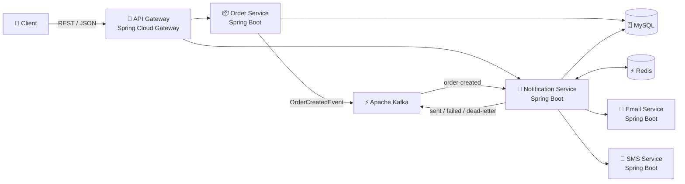
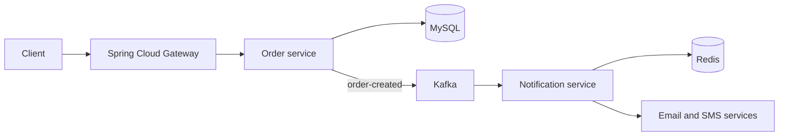

# Etch

Distributed Notification Hub


## What's going on here

Etch is a small notification hub built on Kafka. When someone places an order, the order service answers right away. The emails and texts go out later, in the background, through their own services. So a slow or broken email provider never makes an order fail.

- Place an order, and the answer comes back fast
- Notifications get sent separately, on their own time
- If a send fails, Etch retries it
- If it can never work, Etch parks it safely instead of losing it

## Why I built it

I wanted to understand what happens when the slow, unreliable part of a system sits behind a message queue. Sending a notification is a good example. Email and SMS providers time out, go down, and sometimes reject a message outright. None of that should make an order fail or make a customer wait.

So I built the whole path to see how it holds up. I cared most about the unglamorous parts. Etch is my answer to these questions, kept small enough to read in an afternoon.

- What happens when a send fails?
- How many times should you retry?
- Where does a message go when it can never succeed?
- What stops a customer from getting the same email twice when Kafka redelivers an event?

## How it fits together



Here's the journey of one order.

- The client creates an order through the gateway
- The order service saves it to MySQL and publishes an `order-created` event
- It responds right away, without waiting for any notifications
- The notification service picks up the event
- It creates one notification for each channel requested (email, SMS, or both)
- Each notification goes out through the email or SMS service
- If a send fails temporarily, it's retried with exponential backoff
- If it fails for good, or runs out of retries, it goes to a dead-letter topic instead of being dropped

## What it does

- **Async by design.** Creating an order never waits on delivery
- **Retries and a dead-letter queue.** Temporary failures are retried with backoff, and permanent ones land in the `notification-dlt` topic and get logged
- **No duplicates.** Redis tracks which events and notifications were already handled, so a redelivered Kafka message doesn't send twice
- **Five services, each in its own container.** Gateway, order, notification, email, and SMS
- **Mock providers that fail on purpose.** The email and SMS services are stand-ins, so you can watch the failure handling work
- **Easy to follow in the logs.** Requests carry an `X-Correlation-Id` header
- **Tested.** Unit tests for the logic, plus Testcontainers integration tests against real MySQL, Kafka, and Redis
- **Set up for AWS.** A GitHub Actions pipeline tests the code, builds the Docker images, and deploys to ECS Fargate

## Tech stack

- Java 25
- Spring Boot and Spring Cloud Gateway
- Apache Kafka
- MySQL
- Redis
- JUnit and Testcontainers
- Docker and Docker Compose
- GitHub Actions
- AWS (ECS/Fargate, ECR, RDS, ElastiCache)

## Why these technologies

- **Java and Spring Boot** make web services quick to build
- **Spring Cloud Gateway** gives clients one front door
- **Kafka** lets orders finish without waiting on notifications
- **MySQL** saves orders and notifications
- **Redis** remembers what's handled, so nothing sends twice
- **JUnit and Testcontainers** test against real MySQL, Kafka, and Redis
- **Docker Compose** starts everything in one command
- **GitHub Actions** tests, builds, and deploys changes
- **AWS ECS Fargate** runs the containers without managing servers
- **ECR, RDS, and ElastiCache** store images and host MySQL and Redis



## Running it

You'll need Docker with Compose v2. To build or test outside Docker, you'll also need JDK 25 and Maven 3.9 or newer.

From the repo root, start everything.

```bash
docker compose up -d --build
```

That starts Kafka, MySQL, Redis, and all five services. The first build takes a few minutes. Then you can reach each service here.

| Service | URL |
|---|---|
| API Gateway | http://localhost:8080 |
| Order Service | http://localhost:8081 |
| Notification Service | http://localhost:8082 |
| Email Service (mock) | http://localhost:8083 |
| SMS Service (mock) | http://localhost:8084 |

### Try it

Three demo users are created on startup. Start by creating an order through the gateway.

```bash
curl -s -X POST http://localhost:8080/orders \
  -H 'Content-Type: application/json' \
  -d '{"userId":1,"orderNumber":"ORD-1001","total":49.99,"channels":["EMAIL","SMS"]}'
```

Then look at what happened to its notifications.

```bash
curl -s http://localhost:8080/notifications/order/1
```

The mock services reject some requests on purpose. So create a few more orders, then watch the notification service work through retries and dead-lettering.

```bash
docker compose logs -f notification-service
```

### Stopping it

```bash
docker compose down
```

Add `-v` to also wipe the MySQL volume, so you start clean next time.

## Endpoints

- `POST /orders` creates an order
- `GET /orders` and `GET /orders/{id}` read orders
- `GET /notifications/order/{orderId}` shows the notifications for an order
- The mock providers listen at `POST /email/send` and `POST /sms/send`

## Configuration

Everything has a sensible local default. The `docker-compose.yml` file overrides what needs to change inside containers. These are the ones you're most likely to touch.

| Variable | Used by | Default | What it does |
|---|---|---|---|
| `ORDER_SERVICE_URL`, `NOTIFICATION_SERVICE_URL` | api-gateway | `http://localhost:8081`, `http://localhost:8082` | Where the gateway forwards requests |
| `KAFKA_BOOTSTRAP_SERVERS` | order-service, notification-service | `localhost:9092` | Kafka brokers |
| `DB_HOST`, `DB_PORT`, `DB_NAME`, `DB_USERNAME`, `DB_PASSWORD` | order-service, notification-service | `localhost`, `3306`, one schema per service, `etch`, `etch` | MySQL connection |
| `REDIS_HOST`, `REDIS_PORT` | notification-service | `localhost`, `6379` | Redis, used for deduplication |
| `EMAIL_SERVICE_URL`, `SMS_SERVICE_URL` | notification-service | `http://localhost:8083`, `http://localhost:8084` | Where deliveries are sent |
| `EMAIL_FAILURE_RATE`, `SMS_FAILURE_RATE` | email-service, sms-service | `0.05` | Share of requests the mock rejects permanently |
| `EMAIL_UNAVAILABLE_RATE`, `SMS_UNAVAILABLE_RATE` | email-service, sms-service | `0.0` | Share of requests the mock answers with a 503, which gets retried |

## Testing

Run these from the repo root.

```bash
mvn test      # unit tests
mvn verify    # unit tests plus the Testcontainers integration tests (needs Docker)
```

To test one service along with the shared modules it depends on:

```bash
mvn -pl services/order-service -am test
```

## Project layout

```text
services/
├── api-gateway/
├── order-service/
├── notification-service/
├── email-service/
└── sms-service/

shared/
├── common-events/    event classes shared between services
├── common-dto/       request and response types
└── common-utils/     exceptions and logging helpers

infrastructure/
├── docker/           MySQL init script
└── aws/              ECS task definitions and setup notes

.github/workflows/    CI/CD pipeline
```

## Deployment

The repo is set up to deploy to AWS. The infrastructure itself isn't created by code in this repo, so you set that up once by hand.

- There are ECS task definitions for each service, targeting ECS Fargate
- Images live in ECR, MySQL runs on RDS, and Redis runs on ElastiCache
- The GitHub Actions pipeline runs the tests, builds the images, then pushes and deploys them
- The deploy steps only work once AWS credentials and repository secrets are configured
- The setup notes are in [infrastructure/aws/README.md](infrastructure/aws/README.md)
